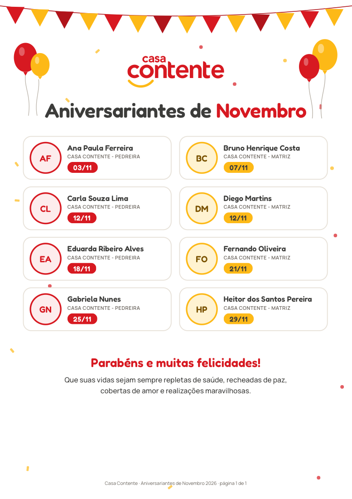
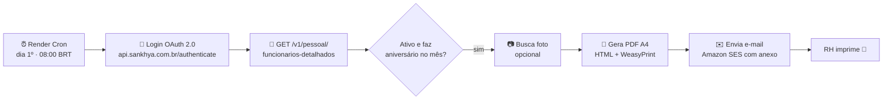
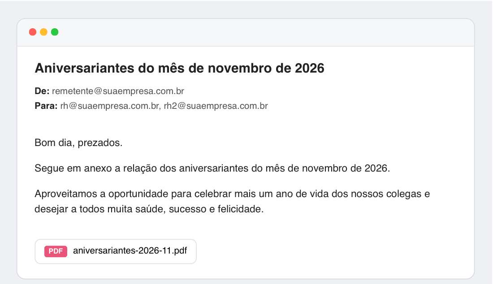

# 🎉 Aniversariantes Casa Contente

Automação que, **todo dia 1º de cada mês às 08:00 (horário de Brasília)**, busca na **Sankhya** os colaboradores **ativos** que fazem aniversário no mês, gera um **PDF festivo pronto para impressão** e envia por e-mail para o RH (destinatários definidos em `EMAIL_DESTINATARIOS`).

Roda como **Cron Job no [Render](https://render.com)** a partir de uma imagem Docker.

<p align="center">
  
</p>

> As imagens deste README usam **dados fictícios**.

---

## Sumário
- [Como funciona](#como-funciona)
- [O PDF](#o-pdf)
- [O e-mail](#o-e-mail)
- [Estrutura do projeto](#estrutura-do-projeto)
- [Configuração (variáveis de ambiente)](#configuração-variáveis-de-ambiente)
- [Rodando localmente](#rodando-localmente)
- [Testando o envio real para o seu e-mail](#testando-o-envio-real-para-o-seu-e-mail)
- [Deploy no Render](#deploy-no-render)
- [Configurando o Amazon SES](#configurando-o-amazon-ses)
- [Fotos dos colaboradores](#fotos-dos-colaboradores)
- [Regras de negócio](#regras-de-negócio)
- [Segurança](#segurança)
- [Solução de problemas](#solução-de-problemas)

---

## Como funciona



1. **Autenticação na Sankhya**: usa o fluxo **oficial e mais recente**, o OAuth 2.0 *Client Credentials* com o header `X-Token`. O login antigo com `appkey` + usuário/senha foi descontinuado pela Sankhya. O token dura cerca de 5 minutos e o cliente o renova sozinho.
   ```http
   POST https://api.sankhya.com.br/authenticate
   X-Token: <token do Gateway>
   Content-Type: application/x-www-form-urlencoded

   client_id=...&client_secret=...&grant_type=client_credentials
   ```
2. **Consulta de funcionários**: usa `GET /v1/pessoal/funcionarios-detalhados`, percorrendo todas as páginas. Se o endpoint não existir no ambiente (módulo Pessoal anterior à 5.126, que é o caso hoje), o script lista os códigos em `GET /v1/pessoal/funcionarios`, filtra os ativos e busca o detalhe de cada um em `GET /v1/pessoal/funcionarios/{codigo}/empresa/{empresa}`, 5 em paralelo. Com cerca de 108 ativos, leva uns 15 segundos.
3. **Filtro**: mantém só os colaboradores **ativos** com nascimento no mês do envio (veja [Regras de negócio](#regras-de-negócio)).
4. **Fotos** (opcional): veja [Fotos dos colaboradores](#fotos-dos-colaboradores).
5. **PDF**: um template HTML/CSS (`templates/aniversariantes.html`) é renderizado com Jinja2 e convertido em PDF pelo WeasyPrint.
6. **E-mail**: enviado pelo **Amazon SES** (API v2, `SendEmail` com conteúdo *raw*), com o PDF em anexo. Veja [Configurando o Amazon SES](#configurando-o-amazon-ses).

## O PDF

- Formato **A4 retrato**, pronto para imprimir e fixar no mural.
- Identidade visual da **Casa Contente** (cores, fontes e logo, as mesmas do site), com clima festivo: bandeirinhas, balões e confetes em vermelho e amarelo.
- Um card por pessoa com **foto** (ou as iniciais), **nome**, **empresa** e **data (DD/MM)**, em ordem de dia.
- A empresa é o **nome fantasia** cadastrado em `TSIEMP` (ex.: "CASA CONTENTE - MATRIZ"). Se ele não estiver disponível, o card mostra a razão social sem sufixos como LTDA ou ME.
- Quando há muitos aniversariantes, a lista continua nas páginas seguintes, sem cortar nenhum card.
- No final vem a mensagem:
  > *Parabéns e muitas felicidades!*
  > Que suas vidas sejam sempre repletas de saúde, recheadas de paz, cobertas de amor e realizações maravilhosas.
- Cores da marca: vermelho `#d71921` e amarelo "sorriso" `#fdb917`, com textos em grafite `#3c3c3a`.
- As fontes da marca ([Fredoka](https://fonts.google.com/specimen/Fredoka) nos títulos e [Manrope](https://fonts.google.com/specimen/Manrope) no texto, licença OFL) e o logo (`templates/logo.svg`) ficam dentro do projeto, então o resultado é o mesmo em qualquer máquina.

## O e-mail

<p align="center">
  
</p>

O mês e o ano mudam automaticamente para o mês do envio.

## Estrutura do projeto

```
aniversariantes-contente/
├── aniversariantes/
│   ├── __main__.py       # orquestra tudo (CLI)
│   ├── sankhya.py        # cliente da API Sankhya: login, funcionários, fotos, filtros
│   ├── pdf.py            # renderiza o template e gera o PDF
│   └── email_sender.py   # envio via Amazon SES com anexo
├── templates/
│   ├── aniversariantes.html  # layout do PDF (HTML + CSS)
│   ├── logo.svg              # logo Casa Contente
│   └── fonts/                # Fredoka + Manrope (fontes da marca)
├── fotos/                # fotos manuais opcionais (ignoradas pelo git)
├── docs/                 # imagens do README
├── Dockerfile            # imagem usada no Render
├── render.yaml           # definição do Cron Job (Blueprint)
├── run.sh                # execução local
├── testar-envio.sh       # teste real enviando só para o seu e-mail
├── requirements.txt
└── .env.example          # modelo das variáveis de ambiente
```

## Configuração (variáveis de ambiente)

Localmente, copie `.env.example` para `.env`. No Render, configure as variáveis no painel (*Environment*).

| Variável | Obrigatória | Descrição |
|---|:-:|---|
| `SANKHYA_CLIENT_ID` | ✅ | Client ID da aplicação (Área do Desenvolvedor Sankhya) |
| `SANKHYA_CLIENT_SECRET` | ✅ | Client Secret da aplicação |
| `SANKHYA_X_TOKEN` | ✅ | Token da tela **Configurações Gateway** no Sankhya Om |
| `SANKHYA_BASE_URL` | | Padrão `https://api.sankhya.com.br` (sandbox: `https://api.sandbox.sankhya.com.br`) |
| `SANKHYA_CODIGO_EMPRESA` | | Filtra uma empresa. Vazio = todas |
| `SITUACOES_ATIVAS` | | Situações consideradas ativas. Padrão `1,2,3,4,5,6,7,9` |
| `MOSTRAR_FOTOS` | | `true`/`false`. Padrão `true` |
| `AWS_ACCESS_KEY_ID` / `AWS_SECRET_ACCESS_KEY` | ✅ | Chaves do usuário IAM que só pode enviar e-mail (veja abaixo) |
| `AWS_REGION` | ✅ | Região onde o SES está configurado: `us-east-2` (a mesma da loja) |
| `EMAIL_REMETENTE` | ✅ | Remetente **verificado no SES**: `Casa Contente <nao-responda@casacontente.com.br>` |
| `SES_CONFIGURATION_SET` | | Configuration set do SES, para métricas de entrega e bounce (opcional; não use o `loja`) |
| `EMAIL_DESTINATARIOS` | ✅ | E-mails do RH, separados por vírgula (ficam só no Render, fora do repositório público) |
| `NOME_EMPRESA` | | Texto do cabeçalho e do rodapé do PDF. Padrão `Casa Contente` |
| `TZ_EMPRESA` | | Fuso usado para definir "o mês atual". Padrão `America/Sao_Paulo` |

> **Sankhya:** funciona com qualquer versão do módulo Pessoal que tenha `/v1/pessoal/funcionarios`. A partir da 5.126.0, usa o `funcionarios-detalhados`, que é mais rápido. Para as fotos, a aplicação precisa de permissão no `DbExplorerSP.executeQuery`.

## Rodando localmente

```bash
# 1. Dependências de sistema do WeasyPrint
brew install pango                                         # macOS
# sudo apt install libpango-1.0-0 libpangoft2-1.0-0        # Ubuntu/Debian

# 2. Ambiente Python
python3 -m venv .venv
.venv/bin/pip install -r requirements.txt
cp .env.example .env    # preencha as credenciais

# 3. Executar
./run.sh --exemplo --sem-email    # PDF com dados fictícios (não acessa Sankhya nem envia e-mail)
./run.sh --sem-email              # PDF real do mês atual, sem enviar
./run.sh --mes 12 --sem-email     # PDF real de dezembro
./run.sh                          # gera e ENVIA para o RH (o mesmo que o Render faz)
```

O PDF fica em `saida/aniversariantes-AAAA-MM.pdf`.

Com Docker, o ambiente fica idêntico ao do Render:
```bash
docker build -t aniversariantes .
docker run --rm --env-file .env aniversariantes python -m aniversariantes --sem-email
```

## Testando o envio real para o seu e-mail

Use `testar-envio.sh` para receber o **arquivo real** (dados da Sankhya) **somente no seu e-mail**. O RH não recebe nada.

```bash
./testar-envio.sh voce@suaempresa.com.br                # mês atual
./testar-envio.sh voce@suaempresa.com.br --mes 12       # outro mês
./testar-envio.sh voce@suaempresa.com.br --exemplo      # dados fictícios (testa só o envio pelo SES)
```

O script equivale a `./run.sh --para voce@suaempresa.com.br`. A opção `--para` pode ser repetida para mandar a mais de um endereço.

**Teste no Render**: abra o Cron Job → **Shell** (ou use `render ssh`) e rode:
```bash
python -m aniversariantes --para voce@suaempresa.com.br
```

## Deploy no Render

O serviço é um **Cron Job** com runtime **Docker**, definido em [`render.yaml`](render.yaml):

| Item | Valor |
|---|---|
| Agenda | `0 11 1 * *` → dia 1º, 11:00 UTC = **08:00 em Brasília** |
| Comando | `python -m aniversariantes` (o `CMD` do Dockerfile) |
| Auto-deploy | a cada push na branch `main` |

**Primeira vez:**
1. No Render, crie o Cron Job apontando para este repositório (ou use **New → Blueprint**, que lê o `render.yaml`).
2. Em **Environment**, preencha as variáveis obrigatórias (`SANKHYA_*`, `AWS_*`, `EMAIL_REMETENTE`, `EMAIL_DESTINATARIOS`).
3. Use **Trigger Run** para disparar uma vez. Atenção: isso envia o e-mail de verdade para o RH. Para um teste seguro, use o Shell com `--para`, como mostrado acima.
4. Os logs de cada execução ficam na aba **Logs**.

## Configurando o Amazon SES

O envio usa o **mesmo Amazon SES da loja virtual** (projeto `loja-casacontente`, `docs/EMAILS-SES.md`), que já está pronto na região **`us-east-2`**:

- identidade do domínio `casacontente.com.br` verificada, com **Easy DKIM** e MAIL FROM `envio.casacontente.com.br` (DNS na Cloudflare);
- conta **fora do sandbox** (acesso de produção aprovado): entrega para qualquer endereço, inclusive os do RH;
- remetente `Casa Contente <nao-responda@casacontente.com.br>`.

Falta só a credencial deste projeto:

1. **Crie um usuário IAM** só para os aniversariantes (recomendado, para não compartilhar a chave do `sync-midia` da loja), com a política mínima abaixo, e gere uma *access key*:
   ```json
   {
     "Version": "2012-10-17",
     "Statement": [{
       "Effect": "Allow",
       "Action": "ses:SendEmail",
       "Resource": "arn:aws:ses:us-east-2:<ID_DA_CONTA>:identity/casacontente.com.br",
       "Condition": { "StringEquals": { "ses:FromAddress": "nao-responda@casacontente.com.br" } }
     }]
   }
   ```
   O envio com anexo usa o `SendEmail` da API v2 (conteúdo *raw*), que é autorizado pela ação `ses:SendEmail`.
   Se usar um configuration set próprio (`SES_CONFIGURATION_SET`), inclua o ARN dele em `Resource`. **Não use o `loja`**: os avisos de bounce/reclamação dele vão para o backend da loja.
2. Cadastre `AWS_ACCESS_KEY_ID`, `AWS_SECRET_ACCESS_KEY` e `EMAIL_REMETENTE` no Render (`AWS_REGION` já vem como `us-east-2` no `render.yaml`).

O limite do SES é de 40 MB por mensagem; o PDF costuma ter menos de 1 MB.

## Fotos dos colaboradores

A API REST de Pessoal da Sankhya **não retorna foto**. O sistema tenta, nesta ordem:

1. **Arquivo local** `fotos/{CODEMP}_{CODFUNC}.jpg` (ou `.png`).
2. **Sankhya**: a coluna `TFPFUN.IMAGEM`, a foto do cadastro do funcionário. A busca usa o serviço `DbExplorerSP.executeQuery` do Gateway, em lotes de até 10 pessoas por consulta. Como o `loadRecords` devolve esse BLOB vazio, o próprio SQL Server converte a imagem para base64. Só leitura; a aplicação precisa de permissão no DbExplorer.
3. **Iniciais do nome** num círculo colorido (fallback).

Uma foto que não carregar **nunca impede o envio**.

> ⚠️ **Este repositório é público.** Fotos de colaboradores são dados pessoais (LGPD). Por isso a pasta `fotos/` está no `.gitignore` e **não deve ser commitada**. Prefira manter as fotos no cadastro da Sankhya (opção 2).

## Regras de negócio

**Quem é "ativo"**: o colaborador entra no PDF quando `dadosContratuais.situacao` está em `SITUACOES_ATIVAS` **e** não tem `afastamento.dataDesligamento`.

| Código | Situação na Sankhya | Entra no PDF? |
|:-:|---|:-:|
| 0 | Demitido | ❌ |
| 1 | Atividade normal | ✅ |
| 2–7 | Afastamentos (sem remuneração, acidente, serviço militar, licença-maternidade, doença > 15 dias, outros) | ✅ |
| 8 | Transferido | ❌ |
| 9 | Aposentadoria por invalidez | ✅ |

Para listar **apenas** quem está trabalhando normalmente, use `SITUACOES_ATIVAS=1`.

Outras regras:
- Usa o **nome social** quando ele estiver preenchido.
- Ordena por dia do aniversário e depois por nome.
- Um colaborador que aparece repetido (mesma empresa + código) entra só uma vez.
- O "mês do envio" é o mês atual no fuso `America/Sao_Paulo`.

## Segurança

- **Nenhuma credencial fica no código.** Tudo vem de variáveis de ambiente. O `.env` está no `.gitignore` e no `.dockerignore`.
- No Render, as variáveis sensíveis (incluindo os e-mails do RH) são cadastradas no painel e não ficam no `render.yaml`.
- A Sankhya e o SES são acessados apenas via HTTPS.
- O usuário IAM do SES tem **permissão mínima**: só pode enviar e-mail a partir da identidade verificada.
- Os PDFs gerados (`saida/`) e as fotos (`fotos/`) **não são versionados**.
- Mensagens de erro não exibem tokens nem senhas.
- Para trocar credenciais, gere um novo *client secret* na Área do Desenvolvedor Sankhya ou um novo X-Token no Sankhya Om e atualize as variáveis no Render.

## Solução de problemas

| Sintoma | Causa provável |
|---|---|
| `Falha na autenticação Sankhya (401)` | `client_id`, `client_secret` ou `X-Token` inválidos ou expirados |
| PDF sem fotos (só iniciais) | Foto não cadastrada em TFPFUN, ou a aplicação não tem permissão no `DbExplorerSP`. O log mostra um aviso com o motivo |
| `MessageRejected: Email address is not verified` | Remetente não verificado no SES; ou a conta ainda está no **sandbox** e o destinatário também não está verificado |
| `AccessDeniedException` (SES) | A política IAM não permite `ses:SendEmail` na identidade, o remetente é outro, ou a `AWS_REGION` não é `us-east-2` |
| `NoCredentialsError` | `AWS_ACCESS_KEY_ID`/`AWS_SECRET_ACCESS_KEY` não configuradas |
| `cannot load library 'libgobject-2.0-0'` (macOS) | Instale o Pango (`brew install pango`). O `run.sh` já ajusta o `DYLD_FALLBACK_LIBRARY_PATH` |
| E-mail não chegou | Confira a aba **Logs** no Render e a caixa de spam |

---

Documentação oficial da Sankhya: [Autenticação OAuth 2.0](https://developer.sankhya.com.br/reference/post_authenticate) · [Funcionários detalhados](https://developer.sankhya.com.br/reference/get_v1-pessoal-funcionarios-detalhados) · [Requisições via Gateway](https://developer.sankhya.com.br/reference/requisições-via-gateway)
